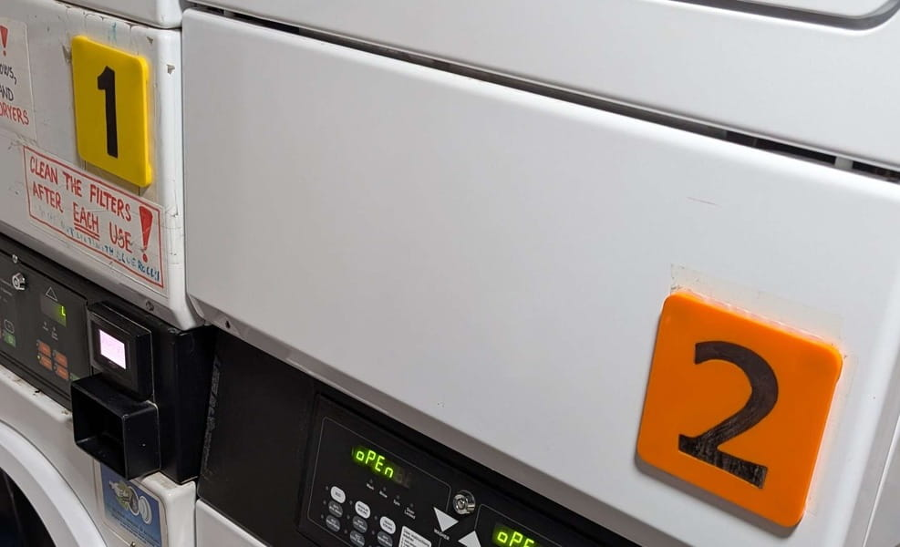

# eshc-laundry

Contains CAD files (if you consider inkscape CAD...) for random ESHC laundryroom stuff.

Stored on GitHub so they don't get lost :D

Originally created by Merlin.

## Machine Number Plates
`machine_plate.svg` contains the original inkscape SVGs.

Intended to not slip around too much if people knock accidently.

[Click for further details on manufacturing](./docs/machine_plate.md)
